

<picture>
  <source media="(prefers-color-scheme: dark)" srcset="https://raw.githubusercontent.com/AKilalours/AKilalours/main/assets/hero-dark.svg" />
  
</picture>

 

 

I build perception, retrieval and ranking systems, and I care most about the part people
skip: proving they actually work. Several of the projects below exist because a harness I
wrote disagreed with a number I had published.

MS Artificial Intelligence at LIU Brooklyn, graduating December 2026. Machine learning
intern on the R&D team at Jaan Health, working on clinical NLP over patient care
timelines.

<!-- Computed in .github/workflows/profile-stats.yml straight from GitHub's GraphQL
     contributionsCollection over a rolling 365 days, the same source the profile
     header uses. Third-party stat services read the public REST API and miss private
     contributions, so their numbers disagree with the profile. These do not. -->

 

## Project reel

<!-- REEL:START -->

     

<table><tr>
<td align="center" width="33%"><a href="https://github.com/AKilalours/opendrivefm">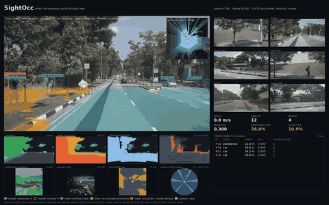</a> OpenDriveFM: occupancy on a held-out nuScenes scene</td>
<td align="center" width="33%"><a href="https://github.com/AKilalours/plumbline">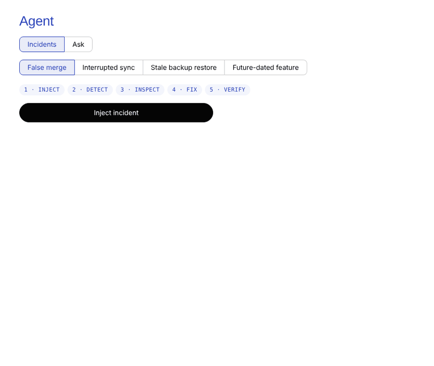</a> Plumbline: a false merge caught, approved, fixed</td>
<td align="center" width="33%"><a href="https://github.com/AKilalours/Gods_Eye">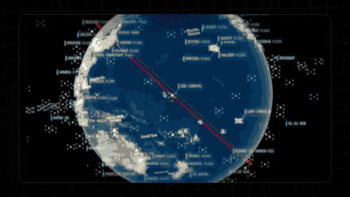</a> God&#x27;s Eye: live public data on a 3D globe</td>
</tr></table>

<!-- REEL:END -->

 

## Explore in 3D

<a href="https://akilalours.github.io/AKilalours/">
  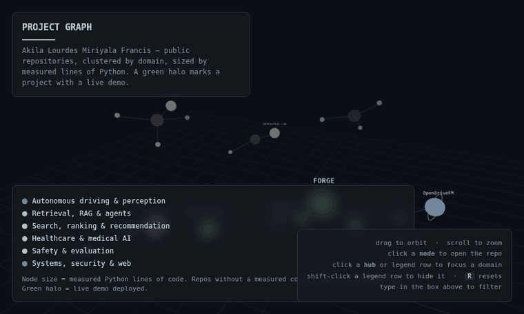
</a>

<b><a href="https://akilalours.github.io/AKilalours/">Open the interactive version</a></b> &nbsp;·&nbsp; drag to orbit, click a node to open the repo

 

## Every repository, by area

Sorted automatically. A new public repo is picked up, categorized and given a card within six hours, by <a href=".github/workflows/repo-catalog.yml">this workflow</a>. 
<b>NEW</b> marks repos created in the last three weeks. A pulsing green dot marks repos pushed to in the last two weeks.

 

<!-- CATALOG:START -->
<!-- generated by .github/scripts/build_catalog.py on 2026-11-10T19:44+00:00 - do not edit by hand -->


<a href="https://github.com/AKilalours/achievements-practice"></a>
<a href="https://github.com/AKilalours/thursday-dinner-concierge"></a>

<a href="https://github.com/AKilalours/opendrivefm"></a>
<a href="https://github.com/AKilalours/guardian-drive"></a>
<a href="https://github.com/AKilalours/Self-Driving-Cars-Specialization"></a>

<a href="https://github.com/AKilalours/Forge"></a>
<a href="https://github.com/AKilalours/neurapilot"></a>
<a href="https://github.com/AKilalours/rag-adversarial-robustness-eval-harness"></a>

<a href="https://github.com/AKilalours/streaming-canvas-search-ltr"></a>
<a href="https://github.com/AKilalours/FashionFinder"></a>

<a href="https://github.com/AKilalours/Esophageal-Cancer-Detection"></a>
<a href="https://github.com/AKilalours/chronicguard-ai"></a>
<a href="https://github.com/AKilalours/Alcohol-detection-using-Decision-tree-and-neural-networks"></a>
<a href="https://github.com/AKilalours/AI-Powered-Health-Risk-Prediction-System-for-Multi-Disease-Diagnosis"></a>
<a href="https://github.com/AKilalours/noise-robust-kws-distress-detection"></a>

<a href="https://github.com/AKilalours/pr-receipts"></a>
<a href="https://github.com/AKilalours/akila-safety-eval-lab"></a>
<a href="https://github.com/AKilalours/StegoCloak"></a>

<a href="https://github.com/AKilalours/plumbline"></a>
<a href="https://github.com/AKilalours/cpg-intelligence-os"></a>
<a href="https://github.com/AKilalours/Crypto-Risk-Bench"></a>

<a href="https://github.com/AKilalours/Gods_Eye"></a>
<a href="https://github.com/AKilalours/portfolio"></a>
<a href="https://github.com/AKilalours/IDEATHON_2022_ACFL"></a>

      

       

<!-- CATALOG:END -->

 

## Deep dives

The cards above are the overview. These open into the method behind each number, the failure case, or a question I have not answered yet. Every card opens. Inside most of them something else opens too: the method behind a number, the failure case, or a question I have not answered yet. Disagree with a number? There is a button for that on every card, and a bot replies with what my data file actually says.

 

<b>OpenDriveFM</b> &nbsp;·&nbsp; trust-aware multi-camera BEV perception &nbsp;nuScenes · PyTorch Lightning

 

Camera-only occupancy and trajectory prediction from six surround cameras, plus the
fault-detection and robustness harness built around it. Every reported number is produced
by a script in the repo and written to a JSON artifact.

**The finding I care about.** The `CameraTrustScorer` is meant to notice when a camera
degrades. The harness scored it as binary classification over 82 held-out frames, 5 fault
types and 6 cameras, with bootstrap CIs over 1,000 resamples:

🎲 <b>Before the table: my trust scorer was supposed to detect degraded cameras. Guess how the first checkpoint scored.</b>

 

Worse than a coin flip. Pooled AUROC **0.434**, with the entire 95% confidence interval
sitting below 0.5.

An AUROC below chance is not a weak model. It is a correctly-learned model wired backwards.
Trust went *up* when a camera was degraded. Had I reported accuracy instead of AUROC, or
skipped the confidence interval, this would have looked like a mediocre component rather
than an inverted one, and I would have spent weeks tuning it instead of fixing the sign.

| Checkpoint | Pooled AUROC | 95% CI |
|---|---|---|
| v11 baseline | 0.434 | [0.419, 0.449] |
| fix v1, pooled hinge | 0.652 | [0.636, 0.668] |
| fix v2, stratified + worst-case | **0.764** | [0.750, 0.777] |

The baseline confidence interval sits entirely below 0.5. The scorer was not weak, it was
inverted: trust went *up* when a camera was degraded. The harness is what caught it.

Also here: a dual-branch trust estimator combining a learned CNN with Laplacian-variance
and Sobel edge-density statistics, trained with a contrastive margin loss; a synthetic
fault-injection suite (blur, glare, occlusion, rain streaks, sensor noise); a transformer
over multi-camera temporal sequences; and a TensorRT-ready graph with no custom CUDA ops.
Inference runs on Apple Silicon via the MPS backend.

▸ <b>How the AUROC was actually measured</b>

 

Each of the 82 held-out frames is replicated across 5 synthetic fault types and 6 cameras,
giving one binary label per camera-frame: degraded or clean. The scorer's continuous trust
output is the score, and AUROC is computed over that pooled set. The 95% interval comes
from 1,000 bootstrap resamples over frames, not over camera-frame pairs, because pairs
drawn from the same frame are not independent and resampling them would give a narrower
interval than the evidence supports.

`fix v2` differs from `fix v1` by stratifying the loss per fault type and optimising the
worst-case type rather than the pooled mean, which is why the gain is larger than the
pooled number alone suggests: glare and rain streaks were dragging the average.

▸ <b>What I would fix next, and what I do not yet know</b>

 

0.764 is a passing score, not a good one. Three things are open:

- The faults are synthetic. A real degraded lens is not a Gaussian blur, and I have no
  measurement on real degradation because I have no labelled real fault data.
- 82 frames is small. The CI is honest about that, but a wider held-out set would move the
  interval more than another loss function would.
- The per-fault-type breakdown is in the artifacts but not on this page. Occlusion is the
  weakest type and I have not published that number, which is the next thing to do.

 

[Repo](https://github.com/AKilalours/opendrivefm) &nbsp;·&nbsp; [Live demo](https://huggingface.co/spaces/Akilalourdes/opendrivefm) &nbsp;·&nbsp; [Ask about this](https://github.com/AKilalours/AKilalours/issues/new?template=ask.yml&title=%5Bask%5D+OpenDriveFM) &nbsp;·&nbsp; [Dispute a number](https://github.com/AKilalours/AKilalours/issues/new?template=dispute.yml&title=%5Bdispute%5D+OpenDriveFM)

<b>FORGE</b> &nbsp;·&nbsp; AI-generated text detection &nbsp;DeBERTa-v3 · FastAPI · 66 tests

 

A detection service for machine-written text, built as a full pipeline rather than a
notebook: DeBERTa-v3 fine-tuned on an RTX 4090, served behind FastAPI, with a Streamlit
front end.

188 Python modules and 66 tests, the most thoroughly tested thing I have written.

▸ <b>Why there is no accuracy number on this card</b>

 

Because I do not have one I would defend. AI-text detection scores are extremely sensitive
to the evaluation set: a detector trained and tested on the same generator family reports
numbers that collapse the moment it meets a model it has not seen, and almost every
published figure in this space quietly benefits from that.

Reporting an in-distribution accuracy here would put a big number on the card and mean
nothing. The number worth publishing is accuracy against text from a generator absent from
training, and until I have run that, this card shows test coverage and stops.

 

[Repo](https://github.com/AKilalours/Forge) &nbsp;·&nbsp; [Ask about this](https://github.com/AKilalours/AKilalours/issues/new?template=ask.yml&title=%5Bask%5D+FORGE) &nbsp;·&nbsp; [Dispute a number](https://github.com/AKilalours/AKilalours/issues/new?template=dispute.yml&title=%5Bdispute%5D+FORGE)

<b>StreamLens</b> &nbsp;·&nbsp; hybrid search and learning-to-rank &nbsp;LightGBM · Kafka · FastAPI

 

A three-stage retrieval pipeline. BM25 and FAISS dense retrieval are merged by a tunable
min-max normalised blend, reranked by a LightGBM LambdaRank model over 15 retrieval and
text-overlap features, then optionally refined by a cross-encoder precision stage.

Event streaming through Kafka with automatic fallback to Redis Streams and then to a
no-op, so the service degrades instead of failing.

The lesson worth telling: inference needed explicit schema-drift reconciliation because
models had been trained against inconsistent feature sets over time. That is a production
ML failure mode you only learn by hitting it.

▸ <b>What schema drift looked like from the inside</b>

 

The symptom was not a crash. It was a ranker that scored plausibly and ranked badly.

A LightGBM model consumes a feature vector by position. When a feature is added to the
extraction code and an older model is loaded against the new extractor, every feature after
the insertion point shifts by one. The model still returns confident floats. Nothing
raises. Ranking quality degrades in a way that looks like a bad model rather than a broken
contract.

The fix is that inference no longer trusts positional order: each model carries the feature
names it was trained on, inference reconciles the live extractor against that list, and a
mismatch fails loudly at load time rather than silently at ranking time.

▸ <b>The number this card does not have</b>

 

NDCG@10 on a held-out query set. The pipeline is built and the reranker trains, but I have
no relevance judgements I did not generate myself, and an NDCG computed against labels I
invented would measure my labelling, not my ranking.

That is the honest state of it. The missing measurement is the reason this is a systems
project on my profile rather than a ranking-quality one.

 

[Repo](https://github.com/AKilalours/streaming-canvas-search-ltr) &nbsp;·&nbsp; [Ask about this](https://github.com/AKilalours/AKilalours/issues/new?template=ask.yml&title=%5Bask%5D+StreamLens) &nbsp;·&nbsp; [Dispute a number](https://github.com/AKilalours/AKilalours/issues/new?template=dispute.yml&title=%5Bdispute%5D+StreamLens)

<b>Guardian Drive</b> &nbsp;·&nbsp; multimodal driver-safety monitoring &nbsp;PointPillars · BEV · physiological signals

 

Physiological signal monitoring fused with a vision perception stack. Built with
[Akilan Manivannan](https://github.com/akilanmanivannan).

A PointPillars 3D detector written from scratch, pillar feature network through voxelizer
to center head, with trained checkpoints. A BEVFormer-style encoder using spatial
cross-attention and temporal self-attention. Visual-inertial odometry with IMU
preintegration and an SO(3) exponential map. A lock-free single-producer single-consumer
ring buffer in C++ for low-latency telemetry handoff.

Ingests nuScenes, Argoverse2, KITTI and BDD100K for vision, WESAD and PTB-XL for
physiological signals. Safety decisions run through a rule-based state machine with
threshold hysteresis, not a learned policy.

▸ <b>Why the safety policy is rules and not a learned model</b>

 

A learned policy would have demoed better. It would also have been the wrong choice.

The output of this system is a decision about whether a person is fit to keep driving. When
that decision is wrong, someone has to explain why it fired, and "the network weighted the
features that way" is not an explanation anyone can act on, audit, or fix in the field. A
state machine with explicit thresholds and hysteresis can be read, argued with, and
adjusted by someone who is not me.

Hysteresis specifically: without it, a signal sitting on a threshold produces alert chatter,
and an alarm that cries wolf is worse than no alarm because people learn to dismiss it.

▸ <b>Which parts are mine and which are Akilan's</b>

 

Worth stating plainly rather than letting a joint project imply solo work. The perception
stack, the PointPillars implementation and the BEV encoder are the parts I own. The
physiological signal pipeline and the fusion logic were built jointly. Ask on the repo if
you need a finer breakdown than that; I would rather answer than have you guess.

 

[Repo](https://github.com/AKilalours/guardian-drive) &nbsp;·&nbsp; [Live demo](https://huggingface.co/spaces/Akilalourdes/guardian-drive-demo) (wakes on first visit) &nbsp;·&nbsp; [Ask about this](https://github.com/AKilalours/AKilalours/issues/new?template=ask.yml&title=%5Bask%5D+Guardian+Drive) &nbsp;·&nbsp; [Dispute a number](https://github.com/AKilalours/AKilalours/issues/new?template=dispute.yml&title=%5Bdispute%5D+Guardian+Drive)

<b>SafetyEval Lab</b> &nbsp;·&nbsp; structured LLM safety evaluation &nbsp;Pydantic · 46 tests · CI

 

A typed framework for evaluating model behaviour across reward hacking, sycophancy and
prompt injection. Pydantic taxonomies for each category, a provider adapter that runs
against a deterministic mock by default and live models only when explicitly enabled, and
Wilson score intervals on pass rates so small-sample results carry honest confidence
bounds rather than a bare percentage.

Framework stage. The default evaluated "model" is a rule-based stub, not an LLM.

🎲 <b>Guess: an eval suite reports 19 passes out of 20. What is the honest way to write that down?</b>

 

Not "95%".

19/20 with a Wilson 95% interval is roughly **[0.764, 0.997]**. The point estimate says 95
and the interval says the true pass rate could plausibly be 76, which is a completely
different system. Reporting the bare percentage takes a result compatible with "fails one
in four times" and prints it as near-perfect.

This is the entire reason the framework computes Wilson rather than the textbook normal
approximation, which misbehaves badly exactly here: at proportions near 1 with small n, it
happily produces upper bounds above 1.0.

▸ <b>Why the default model is a stub, and what that costs this project</b>

 

Two reasons, one good and one not.

The good one: a deterministic stub means the test suite is reproducible and free, so CI can
run the whole thing on every commit without an API key or a bill, and a failing test means
the harness broke rather than a model drifted.

The one that costs me: it also means this repo currently contains zero findings about any
real model. It is a well-built instrument that has not been pointed at anything. That is
the weakest item on this profile, and the fix is not more framework, it is running it
against two real models and publishing the intervals.

 

[Repo](https://github.com/AKilalours/akila-safety-eval-lab) &nbsp;·&nbsp; [Ask about this](https://github.com/AKilalours/AKilalours/issues/new?template=ask.yml&title=%5Bask%5D+SafetyEval+Lab) &nbsp;·&nbsp; [Dispute a number](https://github.com/AKilalours/AKilalours/issues/new?template=dispute.yml&title=%5Bdispute%5D+SafetyEval+Lab)

<b>NeuraPilot</b> &nbsp;·&nbsp; agentic RAG tutoring engine &nbsp;LangGraph · ChromaDB · Ollama

 

A LangGraph state machine, classify to rewrite to retrieve to rerank to generate, over
ChromaDB with MMR retrieval, swappable between local Ollama and OpenAI.

The interesting part is the evaluation. My RAGAS-style harness reported perfect
faithfulness on every question, including a control question the system answered from
model knowledge instead of the documents. The score parser was reading the judge's
sentence count rather than its score and clamping it to 1.0. I fixed the parser,
implemented the grounding guard that had been an accepted-but-unused parameter, and added
regression tests that fail against the old code.

🎲 <b>Guess before you scroll: after the fix, did faithfulness clear my own 0.70 target?</b>

 

No. **0.595**, against a target I set myself at 0.70.

The tempting move here is to quietly lower the target to 0.55, call it met, and publish a
green number. Nobody would ever know. That is exactly the move this project exists to
argue against, so the target stays at 0.70 and the card says missed.

The more useful number is the third one below. Context precision 0.437 says the retriever
is handing the generator mostly irrelevant chunks, which means faithfulness is low because
retrieval is bad, not because generation is unfaithful. Fixing the prompt would have moved
nothing.

Measured after the fix, on 16 questions over two lecture decks with `llama3.1:8b`:
faithfulness **0.595**, answer relevance **0.847**, context precision **0.437**. The
first is below my own 0.70 target and the third says retrieval is the weak stage. Those
are the real numbers.

▸ <b>The bug in detail, and the test that now catches it</b>

 

The judge model returns a short verdict paragraph containing a score. The parser was
supposed to extract that score. It was instead counting sentences in the response and
dividing by itself, which produces 1.0 for any non-empty answer, then clamping to [0, 1],
which hides the arithmetic entirely.

Why it survived: a harness that always reports 1.0 looks like a working system. Every test
passed. The suite had no case where a correct implementation and a broken one had to
disagree.

The regression test now includes a deliberately ungrounded answer to a control question
whose supporting document was removed from the index. The old parser scores it 1.0. The
fixed parser scores it near zero. The test asserts the score is below 0.3, so it fails
against the old code, which is the only property that makes a regression test worth having.

▸ <b>What the grounding guard does now that it is implemented</b>

 

It was an accepted-but-unused parameter, which is its own small lesson: the function
signature promised a behaviour the body never delivered, and nothing in the type system or
the tests noticed, because an ignored argument is valid code.

It now compares the generated answer against the retrieved context before returning, and
refuses to answer rather than answering from model knowledge when the overlap is below
threshold. On the control question, the system now declines instead of confidently
answering from parametric memory. Declining is the correct behaviour for a tutor, and it is
the behaviour the original evaluation claimed to already have.

 

[Repo](https://github.com/AKilalours/neurapilot) &nbsp;·&nbsp; [Ask about this](https://github.com/AKilalours/AKilalours/issues/new?template=ask.yml&title=%5Bask%5D+NeuraPilot) &nbsp;·&nbsp; [Dispute a number](https://github.com/AKilalours/AKilalours/issues/new?template=dispute.yml&title=%5Bdispute%5D+NeuraPilot)

<b>ChronicGuard</b> &nbsp;·&nbsp; patient message triage &nbsp;TF-IDF · SBERT · RAG

 

Classifies inbound patient messages by intent and ordinal risk level, retrieves the
relevant care protocol from ChromaDB, and drafts a response. Built with
[Akilan Manivannan](https://github.com/akilanmanivannan).

The evaluation harness treats urgent-case recall below 0.92 as a hard failure and reports
calibration by Brier score, because a triage system that is well calibrated on average and
misses urgent cases is worse than useless. Trained on synthetic messages.

▸ <b>Why recall is a gate and not a metric</b>

 

Because the two errors are not comparable and averaging them pretends they are.

A false positive routes a routine message to a nurse who spends a minute on it. A false
negative sends someone with a real emergency an automated reply. A single F1 score treats
those as trading against each other at a fixed rate, and any optimiser handed that objective
will happily buy precision with recall, because that is what improves the number.

So urgent recall is not in the objective at all. It is a floor: below 0.92 the run fails
and no other result is reported. Everything else is optimised inside that constraint. The
Brier score sits alongside it because a model can hit the recall floor while being wildly
overconfident, and a confidence number nobody can trust is worse than no confidence number.

▸ <b>The honest limit: synthetic messages</b>

 

Every message this was trained and evaluated on is synthetic. That is a real constraint,
not a footnote.

Synthetic patient messages are written by someone who knows what category they belong to,
so the category is legible in the wording in a way real messages are not. Real ones bury
the urgent detail in the third sentence after two paragraphs about a pharmacy. A model that
performs well here has demonstrated it can learn the mapping, not that it can triage.

Which is why the measured recall is not published on this card. The threshold is real, the
harness is real, and the number would be measuring the wrong thing.

 

[Repo](https://github.com/AKilalours/chronicguard-ai) &nbsp;·&nbsp; [Ask about this](https://github.com/AKilalours/AKilalours/issues/new?template=ask.yml&title=%5Bask%5D+ChronicGuard) &nbsp;·&nbsp; [Dispute a number](https://github.com/AKilalours/AKilalours/issues/new?template=dispute.yml&title=%5Bdispute%5D+ChronicGuard)

<b>GI Lesion Screening</b> &nbsp;·&nbsp; endoscopic image classification &nbsp;EfficientNet-B3 · Grad-CAM

 

EfficientNet-B3 with a dual-head design, binary plus 8-class, on Kvasir v2. Inverse
frequency class weights for the binary head and focal loss for the multi-class head.
Grad-CAM implemented directly with PyTorch forward and backward hooks rather than a
library.

95.44% binary accuracy &nbsp;·&nbsp; 0.991 ROC-AUC &nbsp;·&nbsp; Cohen's κ 0.931 on the 8-class task.

▸ <b>These are my best numbers, and here is why you should discount them</b>

 

0.991 ROC-AUC is the highest figure on this profile and the least informative one.

Kvasir v2 is a curated benchmark: clean frames, balanced-ish classes, consistent capture
conditions, and a fixed set of pathologies. Strong performance on it says the model learned
a benchmark that many models learn. It says nothing about frames with motion blur, poor
insufflation, or a pathology outside the eight classes, which is most of real endoscopy.

Cohen's kappa is on the card next to accuracy for the same reason: kappa corrects for
agreement that would happen by chance given the class distribution, and on an imbalanced
medical set the gap between accuracy and kappa is where the honest reading lives.

The number that would matter is performance on frames from a different scope, hospital and
operator. I do not have that data, so I have not made that claim.

▸ <b>Why Grad-CAM is hand-written here rather than imported</b>

 

Partly to understand it. Forward hooks capture the last convolutional activations, backward
hooks capture the gradients flowing into them, the channel weights are the spatially pooled
gradients, and the map is the ReLU of their weighted sum. Writing it out is a few dozen
lines and removes any doubt about which layer and which gradient a library chose for you.

The practical reason: a dual-head model has two heads to attribute from, and the interesting
question is whether the binary head and the 8-class head are looking at the same region.
When they disagree, the confident binary call is worth distrusting. That comparison is
awkward to express through a library API built around one output.

 

[Repo](https://github.com/AKilalours/Esophageal-Cancer-Detection) &nbsp;·&nbsp; [Ask about this](https://github.com/AKilalours/AKilalours/issues/new?template=ask.yml&title=%5Bask%5D+GI+Lesion+Screening) &nbsp;·&nbsp; [Dispute a number](https://github.com/AKilalours/AKilalours/issues/new?template=dispute.yml&title=%5Bdispute%5D+GI+Lesion+Screening)

<b>Offline Voice RAG Assistant</b> &nbsp;·&nbsp; local speech-to-answer &nbsp;faster-whisper · BGE · Coqui

 

Speech in, retrieved and cited answer out, running locally. faster-whisper for ASR with
int8 CPU quantisation, two retrieval backends compared under measured latency (sparse
TF-IDF against dense BGE-small with a `ms-marco` cross-encoder reranker), Coqui VITS for
speech synthesis. Citation integrity is enforced in the RAG path, with a policy-injection
blocklist and RBAC gating.

▸ <b>What citation integrity enforcement actually rejects</b>

 

A RAG system that cites is not the same as a RAG system whose citations are real. The
common failure is a fluent answer carrying a citation to a chunk that does not support it,
which is worse than no citation, because the citation is what convinces the reader to stop
checking.

Enforcement here means a cited span has to trace back to retrieved context before the
answer is returned. An answer that cites nothing retrievable does not ship with a citation
attached to it.

The policy-injection blocklist is the adjacent problem: retrieved text is untrusted input,
and a document containing instructions is still a document. Content coming out of the index
is treated as data to quote, never as instructions to follow.

▸ <b>The repository name does not match this description, and that is on me</b>

 

This card describes a voice RAG assistant. The repo is called
`rag-adversarial-robustness-eval-harness`. Those read as two different projects, and if you
noticed the mismatch before I pointed it out, your instinct was right to.

The honest history is that the repo started as the robustness harness and grew the voice
pipeline around it without ever being renamed. Renaming it is on the list. Flagging it here
costs less than having you find it and wonder what else on this page is loosely attached to
what it points at.

 

[Repo](https://github.com/AKilalours/rag-adversarial-robustness-eval-harness) &nbsp;·&nbsp; [Ask about this](https://github.com/AKilalours/AKilalours/issues/new?template=ask.yml&title=%5Bask%5D+Offline+Voice+RAG) &nbsp;·&nbsp; [Dispute a number](https://github.com/AKilalours/AKilalours/issues/new?template=dispute.yml&title=%5Bdispute%5D+Offline+Voice+RAG)

 

 

## Contribution activity

<picture>
  <source media="(prefers-color-scheme: dark)" srcset="https://raw.githubusercontent.com/AKilalours/AKilalours/main/profile-3d-contrib/profile-night-green.svg" />
  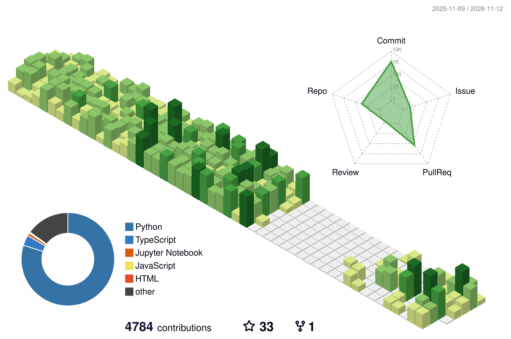
</picture>

<picture>
  <source media="(prefers-color-scheme: dark)" srcset="https://raw.githubusercontent.com/AKilalours/AKilalours/output/snake-dark.svg?v=2" />
  
</picture>

 

## Tools

 

**Modelling** &nbsp; PyTorch · PyTorch Lightning · Transformers · scikit-learn · LightGBM
**Retrieval** &nbsp; LangChain · LangGraph · ChromaDB · FAISS · BM25 · sentence-transformers
**Serving** &nbsp; FastAPI · Streamlit · Docker · Ollama
**Data & streaming** &nbsp; PySpark · Kafka · Redis · SQLite · pandas · NumPy
**Languages** &nbsp; Python · C++ · SQL · TypeScript

 

## Publication

Co-author, *Cryptocurrency price prediction*, AIP Conference Proceedings **3175**, 020004 (2025).
[Google Scholar](https://scholar.google.com/citations?user=1GIm0M8AAAAJ)

 

Brooklyn, NY &nbsp;·&nbsp; <a href="https://www.linkedin.com/in/akila-lourdes-miriyala-francis-5b047019a">LinkedIn</a> &nbsp;·&nbsp; <a href="mailto:akilalourdes@gmail.com">Email</a>

